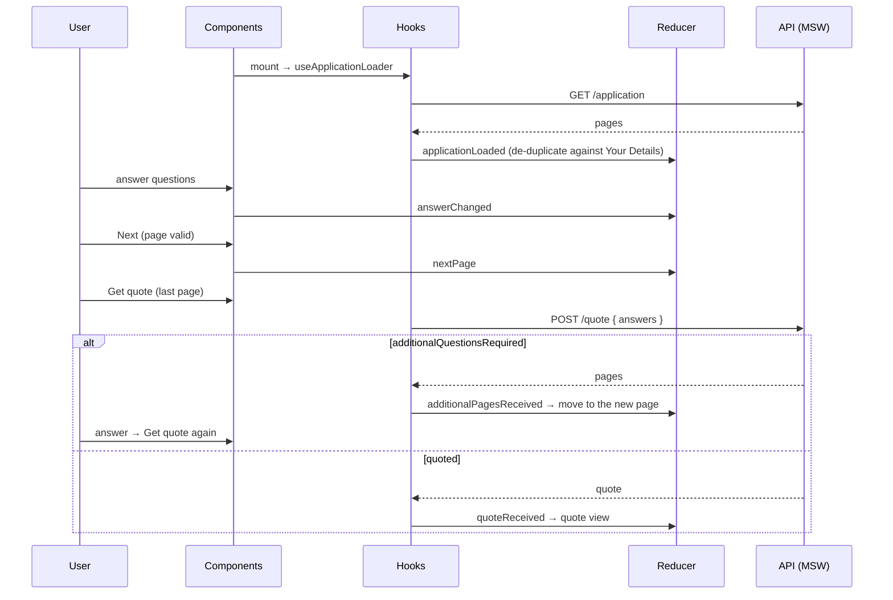

# Life Protect: Insurance Quote Journey

A simplified insurance application journey built with **React 19 + TypeScript**:

**Your Details → Application (About You, Lifestyle, plus any follow-up pages) → Quote**

The application pages come from `GET /application`. Answers are submitted to `POST /quote`, which either returns a quote or asks for more questions. The UI keeps adding the follow-up pages and resubmitting until it gets a quote.

## Table of contents

- [Getting started](#getting-started)
- [Features](#features)
- [Tech stack](#tech-stack)
- [Try it out](#try-it-out)
- [API contract](#api-contract)
- [Mock API](#mock-api)
- [Architecture](#architecture)
- [Key decisions](#key-decisions)
- [Navigation rules](#navigation-rules)
- [Assumptions](#assumptions)
- [Known limitations / next steps](#known-limitations--next-steps)
- [Testing](#testing)
- [Troubleshooting](#troubleshooting)
- [Time spent](#time-spent)
- [AI assistance](#ai-assistance)

---

## Getting started

**Requirements:** Node **18.18+** (tested on 18.20 and 25; also works on 20/22) and npm 9+.

```bash
git clone <repo-url>
cd insurance-quote-journey
npm install
npm start          # opens http://localhost:3000
```

| Script               | Purpose                                    |
| -------------------- | ------------------------------------------ |
| `npm start`          | Vite dev server with the mock API enabled  |
| `npm test`           | Unit and integration tests (Vitest + RTL)  |
| `npm run test:watch` | Tests in watch mode                        |
| `npm run typecheck`  | Strict TypeScript check                    |
| `npm run lint`       | ESLint (including `react-hooks` rules)     |
| `npm run format`     | Prettier                                   |
| `npm run build`      | Type-check and production build in `dist/` |
| `npm run preview`    | Serve the production build locally         |

### Environment variables

Optional. Copy `.env.example` to `.env.local` to change them.

| Variable            | Default | Description                                                |
| ------------------- | ------- | ---------------------------------------------------------- |
| `VITE_ENABLE_MOCKS` | `true`  | Set to `false` to turn off the in-browser mock API (MSW)   |
| `VITE_API_BASE_URL` | _empty_ | Base URL of a real API (requests are same-origin if empty) |

---

## Features

- Three-step journey with a progress sidebar (numbered steps, expandable sub-steps, completed ticks) based on the wireframe.
- **Pages come from the server.** `GET /application` decides which pages and questions appear.
- **Follow-up loop.** `POST /quote` can return more pages. They are added to the journey and the user resubmits until a quote comes back.
- **Validation.** Required fields plus format checks (email, Australian phone number, whole-number ranges). Errors show after a field is blurred or after Next is clicked, and focus moves to the first invalid field.
- **Free navigation.** Back, or jump to any completed page from the sidebar, without losing answers.
- **Stale data handling.** Changing an earlier answer removes follow-up pages and the quote that depended on it.
- **Quote summary.** Premium, cover amount and a summary of every answer, with an _Edit_ link per section and a _Start a new quote_ button.
- **Loading, error and retry states** for both API calls, plus an `ErrorBoundary` fallback.
- **Accessible** (labels, ARIA wiring, focus management, live regions, reduced motion) and **responsive** down to mobile widths.

## Tech stack

| Concern    | Choice                                              | Why                                                           |
| ---------- | --------------------------------------------------- | ------------------------------------------------------------- |
| Framework  | React 19 + TypeScript (strict)                      | Hooks-based composition with full type safety                 |
| Build tool | Vite 5                                              | Fast dev server, simple config, runs on Node 18               |
| State      | `useReducer` + Context (state and dispatch split)   | Enough for one feature, so no extra dependency                |
| Styling    | CSS Modules + CSS custom properties (tokens)        | Scoped styles and a small design-token layer, no runtime cost |
| Mock API   | MSW 2                                               | Intercepts real `fetch` calls, shared by browser and tests    |
| Testing    | Vitest + React Testing Library + user-event         | Tests behaviour the way a user interacts                      |
| Quality    | ESLint 9 (typescript-eslint, react-hooks), Prettier | Consistent, hook-safe code                                    |

No form, state or icon libraries are used. Validation, async handling and icons are small, purpose-built pieces.

---

## Try it out

1. **Validation.** On _Your Details_, click **Next** with empty fields. Errors appear and the email field gets focus. Type an invalid email, tab away, and the format error shows.
2. **Non-smoker path.** Enter `jane@example.com` / `0400 123 456` → **Next** → choose _Office / Professional_ → **Next** → _No_ → **Get quote**. The quote is **$64.85 / month** for **$500,000** cover.
3. **Smoker path (follow-up loop).** Same as above but answer _Yes_. A new **Smoking Details** page appears in the sidebar. Enter `20` → **Get quote** → a higher premium.
4. **Stale data.** From the quote, click **Edit** on _Lifestyle_ and change _Yes_ to _No_. _Smoking Details_ disappears and the next **Get quote** returns a new quote.
5. **API error.** Use `fail@example.com` as the email. **Get quote** shows an inline error and you stay on the page.
6. **Responsive.** Narrow the browser below 768px and the sidebar moves above the form.

---

## API contract

### `GET /application`

```json
{
  "pages": [
    { "title": "About You", "questions": ["email", "phone", "occupation"] },
    { "title": "Lifestyle", "questions": ["smokedLast12Months"] }
  ]
}
```

### `POST /quote`

Request (assumed, since the brief doesn't define it):

```json
{
  "answers": {
    "email": "jane@example.com",
    "phone": "0400123456",
    "occupation": "officeProfessional",
    "smokedLast12Months": true
  }
}
```

Response: either more questions…

```json
{
  "status": "additionalQuestionsRequired",
  "pages": [{ "title": "Smoking Details", "questions": ["cigarettesPerWeek"] }]
}
```

…or a quote:

```json
{
  "status": "quoted",
  "quote": { "product": "Life Protect", "coverAmount": 500000, "premium": 64.85 }
}
```

Every response is checked by runtime type guards (`src/api/guards.ts`) before the app uses it.

## Mock API

No real backend was provided, so [MSW](https://mswjs.io) intercepts `fetch` at the network layer, both in the browser (service worker) and in tests (Node). The app code makes real HTTP calls and doesn't know it's talking to a mock. Switching to a real backend only needs the env vars above.

The mock (`src/mocks/quoteEngine.ts`) behaves like this:

| Scenario                 | Behaviour                                                                             |
| ------------------------ | ------------------------------------------------------------------------------------- |
| Non-smoker               | Returns a quote straight away (Office/Professional = **$64.85**, matching the sample) |
| Smoker, first submit     | `additionalQuestionsRequired` with the _Smoking Details_ page (`cigarettesPerWeek`)   |
| Smoker, second submit    | Quote with a smoker loading based on cigarettes per week                              |
| Email `fail@example.com` | `503`, to show the error state                                                        |
| Missing required answers | `400` with a message                                                                  |
| All requests             | 600 ms simulated latency, so loading states are visible                               |

---

## Architecture

### Project structure

```
src/
├── api/                        # Network boundary
│   ├── httpClient.ts           # fetch wrapper: base URL, JSON, typed ApiError, abort support
│   ├── guards.ts               # Runtime response validation
│   ├── insuranceApi.ts         # getApplication(), requestQuote()
│   └── types.ts                # Wire contract types
├── app/                        # App shell (header, ErrorBoundary, provider)
├── components/
│   ├── ui/                     # Reusable primitives: Button, Card, Alert, FormField,
│   │                           #   TextInput, Select, RadioGroup, Spinner, a11y helpers
│   ├── icons/Icon.tsx          # Inline SVG icon set (no dependency)
│   └── ErrorBoundary.tsx
├── features/journey/           # The feature (public API via index.ts)
│   ├── questions/
│   │   ├── registry.ts         # Question id → label, type, options, validators, serialize
│   │   ├── validators.ts       # Composable validators (required, email, auPhone, …)
│   │   └── validation.ts       # Validates a page's questions against the answers
│   ├── state/
│   │   ├── reducer.ts          # Journey state machine (pure)
│   │   ├── actions.ts          # Typed action creators
│   │   ├── selectors.ts        # Derived data: sidebar model, quote payload, summary
│   │   ├── pageFactory.ts      # API pages → journey pages (de-duplication)
│   │   ├── context.ts          # Split state/dispatch contexts and hooks
│   │   ├── JourneyProvider.tsx
│   │   └── steps.ts            # Step config and the static "Your Details" page
│   ├── hooks/
│   │   ├── useApplicationLoader.ts
│   │   ├── useQuoteSubmission.ts
│   │   ├── useJourneyNavigation.ts
│   │   └── usePageForm.ts
│   ├── components/
│   │   ├── StepNav/            # StepNav → StepNavItem → SubStepItem, StepBadge
│   │   ├── fields/             # QuestionField → InputQuestion | SelectQuestion | RadioQuestion
│   │   ├── PageCard/           # Card shell: icon header, body, footer
│   │   ├── QuoteResult/        # QuoteResult → QuoteHighlight, AnswerSummary
│   │   ├── Status/             # LoadingState, ErrorState
│   │   ├── QuestionPage.tsx
│   │   ├── JourneyContent.tsx  # Picks loading / error / page / quote
│   │   └── JourneyLayout.tsx
│   ├── __tests__/
│   └── Journey.tsx             # Feature entry: wires the hooks into the layout
├── hooks/                      # Generic hooks: useAsyncTask, useLatest, useFocusOnMount
├── mocks/                      # MSW handlers, fixtures, mock underwriting engine
├── styles/global.css           # Design tokens and resets
├── test/                       # Test setup and render helpers
└── utils/                      # cx(), currency formatting
```

### Component tree

```
App
└── ErrorBoundary
    └── JourneyProvider                 (useReducer: state + dispatch contexts)
        └── Journey                     (useApplicationLoader, useJourneyNavigation)
            └── JourneyLayout
                ├── StepNav
                │   └── StepNavItem ×3
                │       └── SubStepItem ×n
                └── JourneyContent
                    ├── LoadingState | ErrorState
                    ├── QuestionPage    (usePageForm; keyed by page id)
                    │   └── PageCard
                    │       └── QuestionField ×n  (React.memo)
                    │           └── InputQuestion | SelectQuestion | RadioQuestion
                    └── QuoteResult
                        └── PageCard → QuoteHighlight, AnswerSummary
```

### Data flow



## Key decisions

**1. Forms are driven by the server's schema.** The API only sends question _ids_. A **question registry** (`questions/registry.ts`) maps each id to its label, control type, options, validators and a `serialize` function (for example `"yes"` → `true`, `"20"` → `20`). Pages are rendered from that data, so if the backend adds or moves a question, no component changes. Unknown ids fall back to a required text field instead of crashing, so the backend can ship a new question before the frontend knows about it.

**2. A pure reducer acts as the journey state machine.** All transitions (`nextPage`, `additionalPagesReceived`, `quoteReceived`, `answerChanged`, …) live in one reducer that is easy to unit test. Views read state through **selectors** (`selectStepNav`, `selectQuotePayload`, …), so derivation logic stays out of components.

**3. State and dispatch use separate contexts.** Components that only dispatch don't re-render when state changes.

**4. Data fetching sits behind hooks.** `useAsyncTask` is a generic hook for abortable requests. It cancels the previous request when a new one starts, cancels on unmount (StrictMode safe, no stale responses), and returns a stable `run`. The feature hooks build on it:

- `useApplicationLoader` loads the pages and supports retry.
- `useQuoteSubmission` runs the quote loop and guards against infinite loops: if the API asks again for questions that were already answered, it shows an error instead of looping.
- `useJourneyNavigation` returns **stable callbacks**. They read the latest state through `useLatest`, which avoids both stale closures and callbacks that change on every render.

**5. Memoisation is used only where it helps.** `QuestionField` is wrapped in `React.memo` and gets id-based stable handlers (`onChange(id, value)`), so typing in one field re-renders only that field. `useMemo` is used for derived selectors and validation. Cheap components aren't memoised, because memoising everything adds cost and noise.

**6. Validation errors are derived, not stored.** `usePageForm` recomputes errors from answers. They show after a field is blurred or after the user tries to continue. On a failed submit, focus moves to the first invalid field (`flushSync` makes sure the error is in the DOM first). Each page is keyed by id, so touched state resets per page without effects.

**7. Small, single-purpose components.** UI primitives (`components/ui`) know nothing about the journey. Feature components combine them. Container logic (`Journey`, `JourneyContent`) is separate from presentational components (`QuoteResult`, `StepNav`, `PageCard`), which only take props.

**8. Accessibility.** Labels are linked to their controls, `aria-invalid` and `aria-describedby` connect hints and errors, radios sit in a `fieldset`/`legend`, the progress nav has `aria-current="step"`, the page heading takes focus on navigation so screen readers announce it, live regions cover loading and error states, and `prefers-reduced-motion` is respected.

**9. Types are checked at the network boundary.** Responses go through type guards (`api/guards.ts`), so a bad payload fails clearly in one place instead of deep inside the UI.

## Navigation rules

- **Back** is always allowed and answers are kept.
- The sidebar lets you jump to any completed page. Jumping _forward_ also requires the current page to be valid.
- If an earlier answer changes, any **follow-up pages and the quote become stale** and are removed. Their answers are kept, so a re-asked question is pre-filled. Only answers for questions currently in the journey are sent to the API.
- If nothing has changed since the last quote, _Get quote_ shows the existing quote instead of calling the API again.

---

## Assumptions

- **Your Details vs. the API's "About You" page.** The brief puts Email/Phone under _Your Details_, but the sample `GET /application` response includes them under _About You_. The frontend owns the _Your Details_ step and removes those questions from the server pages, so nobody is asked twice. Pages left empty after that are dropped.
- **Additional pages belong to the Application step** and appear as extra sub-steps in the sidebar.
- **Request shape.** The brief doesn't define the `POST /quote` body. I assumed `{ "answers": { [questionId]: value } }`, with values serialised to their natural types (booleans for yes/no, numbers for counts).
- **Question metadata** (labels, occupation options, validation rules) isn't in the API, so it lives in the frontend registry.
- **Phone numbers** are validated as Australian, based on the `0400 000 000` placeholder and AUD formatting.
- **The premium is shown as monthly.** The sample response has no period.
- **The wireframe is a visual guide only.** It shows every question on one _About You_ page, but the requirements and the API split them across pages, so the requirements were followed.

## Known limitations / next steps

- **No URL routing or persistence.** Refreshing the page restarts the journey. Next steps would be React Router with step-based URLs and saving the draft to `sessionStorage` (leaving PII out of `localStorage`).
- **Field rendering metadata lives on the client.** Ideally the API would return question metadata (type, label, options, rules), or there would be a shared schema, so new questions could be added without a frontend release.
- **No end-to-end tests.** I'd add Playwright for real-browser coverage, plus visual regression tests.
- **Error handling.** API errors appear inline with retry. There is no telemetry or error reporting yet (the `ErrorBoundary` has a hook point for it).
- **Internationalisation.** Copy is hard-coded in English.
- **Toolchain.** Vite 5 / Vitest 2 are pinned so everything runs on Node 18. `npm audit` reports advisories in those **dev-only** tools (esbuild dev server, etc.), not in the shipped app. On Node 20+ I'd upgrade to Vite 6+/Vitest 3+. The MSW CLI (`msw init`) needs Node 20+, so `public/mockServiceWorker.js` is committed instead.

---

## Testing

```bash
npm test
```

37 tests:

| Type        | File                           | Covers                                                                                                                                                          |
| ----------- | ------------------------------ | --------------------------------------------------------------------------------------------------------------------------------------------------------------- |
| Unit        | `validators.test.ts`           | required, email, AU phone, integer range, oneOf, validator ordering                                                                                             |
| Unit        | `reducer.test.ts`              | Page de-duplication, progression, follow-up pages, reachability guard, stale-data invalidation, restart                                                         |
| Unit        | `selectors.test.ts`            | Payload serialisation (and leaving out stale answers), sidebar status model                                                                                     |
| Integration | `journey.integration.test.tsx` | Required-field validation and focus, blur validation, non-smoker quote, smoker follow-up loop, back keeping answers, quote API failure, load failure with retry |

Integration tests render the whole `<App />` and talk to the same MSW handlers the browser uses, so they cover the real request/response cycle.

`src/test/setup.ts` wraps `fetch` so that jsdom's `AbortSignal` works with Node's built-in `fetch`. Newer Node versions reject non-native signals, and without the wrapper every API call fails in tests.

## Troubleshooting

| Problem                                           | Fix                                                                                            |
| ------------------------------------------------- | ---------------------------------------------------------------------------------------------- |
| Page stuck on "Loading your application…"         | Hard-refresh so the MSW service worker registers. Make sure `VITE_ENABLE_MOCKS` isn't `false`. |
| Port 3000 already in use                          | `npm start -- --port 3001`                                                                     |
| `npx msw init` fails on Node 18                   | Not needed: `public/mockServiceWorker.js` is already committed.                                |
| Unexpected URL path (e.g. `/false`) when starting | Don't pass `--open false`. Vite treats the value as a path. Plain `npm start` opens `/`.       |

---

## Time spent

Approximately **1.5 hours**

## AI assistance

I used an AI coding assistant (Claude Code) during development for:

- Scaffolding the project setup.
- Drafting components, hooks and tests from the architecture described above.
- Reviewing edge cases (stale follow-up pages, infinite quote loops, focus management).

All architectural decisions, the trade-offs above and the final code were reviewed and verified by me: the type check, lint, test suite and a manual run through every scenario in [Try it out](#try-it-out).
